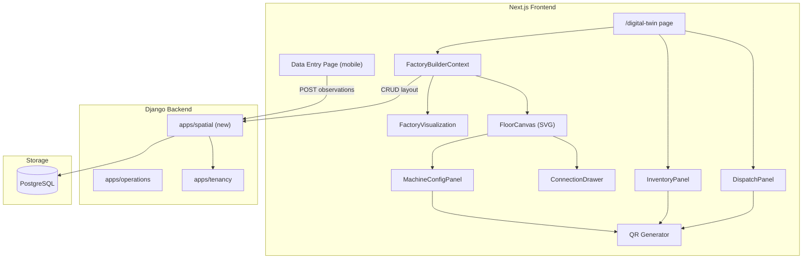
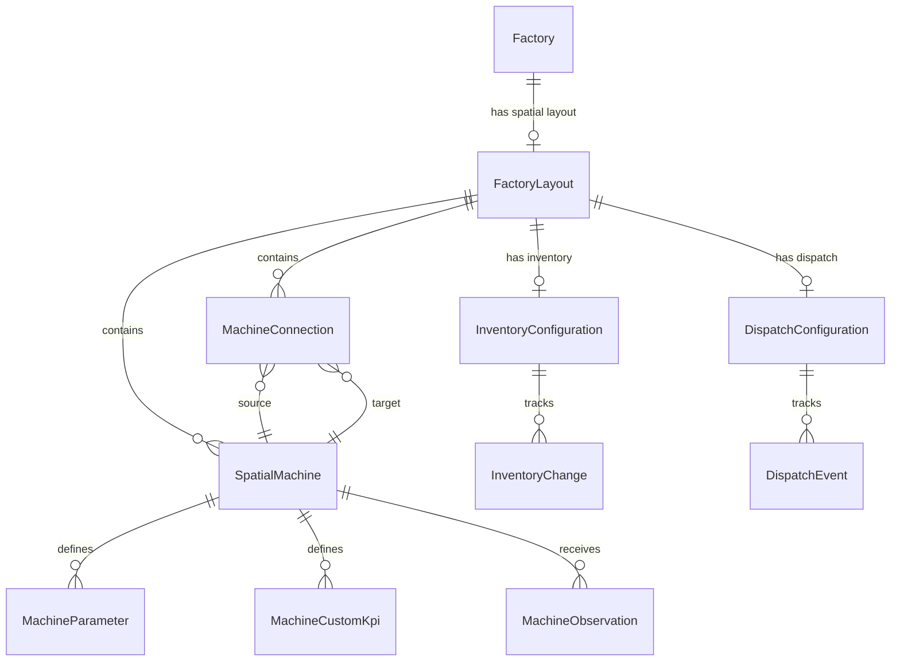
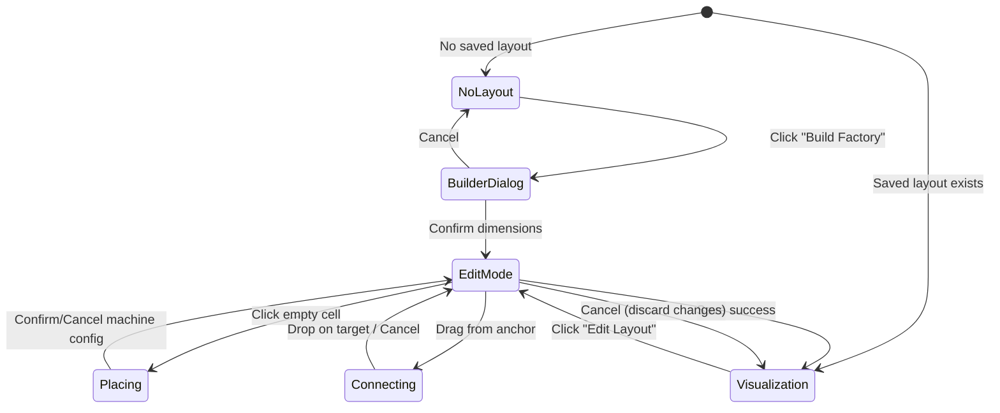

# Design Document: Factory Twin Builder

## Overview

The Factory Twin Builder transforms the existing read-only Digital Twin page into an interactive spatial factory setup and visualization tool. It introduces a GUI-driven workflow for building factory floor layouts on a 2D grid, placing configurable machines, drawing material-flow connections, setting up inventory/dispatch panels, and generating QR codes for mobile data entry. After setup, the saved layout renders as an interactive visualization with 3D box placeholders, hover summaries, and tap-to-inspect analytics.

The system spans frontend (Next.js 16, React 19, TypeScript) and backend (Django REST Framework), integrated with the existing multi-tenant architecture. The frontend replaces the current `DigitalTwin` component with a dual-mode component: an edit/builder mode and a visualization mode.

### Key Design Decisions

1. **SVG over Canvas/WebGL for the floor grid** — SVG provides DOM-level interactivity (hover, click, drag) with React's declarative model. For grids up to 10,000×10,000 units, we virtualize visible cells rather than rendering all. No additional drawing library (react-konva) needed; custom SVG with pointer events is sufficient and avoids a new dependency.

2. **Client-side QR generation** — Using the `qrcode` npm package (lightweight, no server round-trip). QR codes encode platform URLs with machine/inventory/dispatch identifiers. Generation happens immediately on save without backend involvement.

3. **ECharts treemap for inventory/dispatch** — Already in dependencies. The treemap chart type maps directly to the requirement's proportional-area visualization.

4. **CSS isometric transforms for 3D placeholders** — No WebGL. Simple `transform: rotateX() rotateY()` on SVG/div elements produces the box appearance at negligible cost.

5. **New Django app `spatial`** — Dedicated app under `backend/apps/spatial/` for floor layout models, keeping spatial concerns separate from `operations` (uploads) and `tenancy` (factory config).

6. **Dedicated `FactoryBuilderContext`** — A new React context manages builder state (edit mode, placement, connections, undo stack) independent of the existing `FactoryContext` which handles the read-only analytics workspace.

---

## Architecture

### System Context



### Data Flow

```mermaid
sequenceDiagram
    participant U as User
    participant FE as Frontend
    participant API as Django API
    participant DB as PostgreSQL

    Note over U,FE: Builder Mode
    U->>FE: Click "Build Factory"
    FE->>FE: Open dialog, collect dimensions
    U->>FE: Place machine on grid
    FE->>FE: Open config panel
    U->>FE: Configure params, KPIs
    U->>FE: Draw connections
    U->>FE: Click "Save Factory"
    FE->>API: POST /api/backend/api/spatial/layouts/
    API->>DB: Persist layout + machines + connections
    API-->>FE: 201 Created (layout_id)
    FE->>FE: Generate QR codes (client-side)
    FE->>FE: Transition to visualization mode

    Note over U,FE: Data Entry via QR
    U->>FE: Scan QR code (mobile)
    FE->>API: GET /api/backend/api/spatial/machines/{id}/entry-schema/
    API-->>FE: Field definitions
    U->>FE: Submit observation
    FE->>API: POST /api/backend/api/spatial/machines/{id}/observations/
    API->>DB: Store observation row
    API-->>FE: 201 Created
```



---

## Components and Interfaces

### Frontend Component Tree

```
app/digital-twin/page.tsx
└── FactoryTwinPage
    ├── FactoryBuilderProvider (context)
    │   ├── BuilderToolbar (save, edit, cancel actions)
    │   ├── InventoryPanel
    │   │   └── ECharts TreeMap
    │   ├── FloorCanvas (SVG)
    │   │   ├── GridLayer (virtual grid lines + axis labels)
    │   │   ├── MachineNodeLayer (placed machines)
    │   │   ├── ConnectionLineLayer (connection lines with arrows)
    │   │   └── InteractionLayer (cursor highlight, drag preview)
    │   ├── DispatchPanel
    │   │   └── ECharts TreeMap
    │   ├── MachineConfigPanel (slide-over)
    │   │   ├── BasicInfoSection (name, I/O specs)
    │   │   ├── ParametersSection (key/type pairs)
    │   │   ├── KpiSection (formula builder)
    │   │   └── QrCodePreview
    │   └── ConnectionConfigPanel (slide-over)
    └── FactoryVisualization (view mode)
        ├── IsometricFloor (CSS 3D transforms)
        ├── MachineBox3D (per machine)
        ├── ConnectionPath (SVG curves)
        ├── MachineTooltip (hover/longpress)
        └── MachineDetailPanel (click/tap)
```

### Key Interfaces (TypeScript)

```typescript
// lib/spatial-types.ts

export type UnitSystem = "feet" | "meters";
export type MachineStatus = "running" | "warning" | "down" | "idle" | "no_data";
export type ParamDataType = "number" | "text" | "boolean" | "date" | "selection";

export interface FloorDimensions {
  width: number;   // 1–10,000
  height: number;  // 1–10,000
  unit: UnitSystem;
}

export interface GridPosition {
  x: number; // column index (0-based)
  y: number; // row index (0-based)
}

export interface MachineParameter {
  id: string;
  key: string;           // 1–64 chars, alphanumeric + underscore
  dataType: ParamDataType;
  options?: string[];    // for "selection" type, up to 20 items
  required: boolean;
  order: number;
}

export interface IOSpec {
  id: string;
  label: string;   // 1–30 chars
  unitType: string;
}

export interface CustomKpi {
  id: string;
  name: string;          // 1–50 chars, unique per machine
  displayUnit: string;   // 1–20 chars
  formula: KpiFormula;
}

export interface KpiFormula {
  operations: KpiOperation[]; // max 10 parameter references total
}

export interface KpiOperation {
  operator: "add" | "subtract" | "multiply" | "divide";
  parameterKey: string; // references a numeric MachineParameter
}

export interface MachineNode {
  id: string;
  name: string;         // 1–50 chars
  position: GridPosition;
  inputs: IOSpec[];     // 0–10
  outputs: IOSpec[];    // 0–10
  parameters: MachineParameter[];  // 0–50
  customKpis: CustomKpi[];         // 0–20
  status?: MachineStatus;
}

export interface ConnectionLine {
  id: string;
  sourceId: string;     // Machine_Node id
  targetId: string;     // Machine_Node id
  name?: string;        // max 50 chars
  description?: string; // max 200 chars
  materialType?: string;      // max 100 chars
  quantityPerCycle?: number;  // 0.01–999,999,999.99
  inputSpec?: string;
  outputSpec?: string;
  distance?: number;    // computed from grid positions
}

export interface InventoryMaterial {
  id: string;
  name: string;       // max 100 chars
  unit: "kilograms" | "litres" | "meters" | "units";
  quantity: number;   // 0 to storageCapacity
}

export interface InventoryConfig {
  storageCapacity: number;  // 1–1,000,000
  capacityUnit: "kilograms" | "litres" | "meters" | "units";
  materials: InventoryMaterial[];  // 1–50
}

export interface DispatchProduct {
  id: string;
  name: string;       // 1–50 chars
  unit: "meters" | "litres" | "units" | "kilograms";
  awaitingQuantity: number;
}

export interface DispatchConfig {
  products: DispatchProduct[];  // 1–50
}

export interface FactoryLayout {
  id: string;
  factoryId: string;
  floor: FloorDimensions;
  machines: MachineNode[];
  connections: ConnectionLine[];
  inventory?: InventoryConfig;
  dispatch?: DispatchConfig;
  savedAt?: string;
}

// Builder state
export type BuilderMode = "idle" | "placing" | "connecting" | "configuring";

export interface BuilderState {
  layout: FactoryLayout;
  mode: BuilderMode;
  selectedMachineId: string | null;
  selectedConnectionId: string | null;
  isDirty: boolean;
  isEditingExisting: boolean;
}
```

### Backend API Contract

All endpoints are prefixed with `/api/backend/api/spatial/` and require authentication. Tenant scoping is enforced via the existing middleware (user's active tenant).

| Method | Path | Description |
|--------|------|-------------|
| POST | `/layouts/` | Create new factory layout |
| GET | `/layouts/?factory={id}` | Retrieve layout for factory |
| PATCH | `/layouts/{id}/` | Update existing layout |
| GET | `/machines/{id}/entry-schema/` | Get data entry field definitions |
| POST | `/machines/{id}/observations/` | Submit observation row |
| GET | `/machines/{id}/observations/` | Get latest observations |
| POST | `/inventory/{layout_id}/changes/` | Submit inventory addition/removal |
| GET | `/inventory/{layout_id}/` | Get current inventory state |
| POST | `/dispatch/{layout_id}/events/` | Submit dispatch event |
| GET | `/dispatch/{layout_id}/` | Get current dispatch state |

---

## Data Models

### Django Models (`backend/apps/spatial/models.py`)

```python
from django.db import models
from apps.common.models import TenantScopedModel, UUIDModel
from apps.tenancy.models import Factory


class UnitSystem(models.TextChoices):
    FEET = "feet", "Feet"
    METERS = "meters", "Meters"


class MachineOperationalStatus(models.TextChoices):
    RUNNING = "running", "Running"
    WARNING = "warning", "Warning"
    DOWN = "down", "Down"
    IDLE = "idle", "Idle"
    NO_DATA = "no_data", "No data"


class ParamDataType(models.TextChoices):
    NUMBER = "number", "Number"
    TEXT = "text", "Text"
    BOOLEAN = "boolean", "Boolean"
    DATE = "date", "Date"
    SELECTION = "selection", "Selection"


class FactoryLayout(UUIDModel, TenantScopedModel):
    """Root entity representing a spatial factory layout."""
    factory = models.OneToOneField(
        Factory, on_delete=models.CASCADE, related_name="spatial_layout"
    )
    floor_width = models.DecimalField(max_digits=7, decimal_places=1)
    floor_height = models.DecimalField(max_digits=7, decimal_places=1)
    unit_system = models.CharField(
        max_length=10, choices=UnitSystem.choices, default=UnitSystem.METERS
    )
    is_active = models.BooleanField(default=True)

    class Meta:
        indexes = [
            models.Index(fields=["tenant", "factory"]),
        ]


class SpatialMachine(UUIDModel, TenantScopedModel):
    """A machine placed on the factory floor grid."""
    layout = models.ForeignKey(
        FactoryLayout, on_delete=models.CASCADE, related_name="machines"
    )
    name = models.CharField(max_length=50)
    position_x = models.PositiveIntegerField()  # grid column
    position_y = models.PositiveIntegerField()  # grid row
    inputs = models.JSONField(default=list, blank=True)   # [{id, label, unitType}]
    outputs = models.JSONField(default=list, blank=True)  # [{id, label, unitType}]
    status = models.CharField(
        max_length=10, choices=MachineOperationalStatus.choices,
        default=MachineOperationalStatus.NO_DATA
    )
    display_order = models.PositiveIntegerField(default=0)

    class Meta:
        constraints = [
            models.UniqueConstraint(
                fields=["layout", "position_x", "position_y"],
                name="unique_machine_position_per_layout"
            ),
        ]
        indexes = [
            models.Index(fields=["tenant", "layout"]),
        ]


class MachineParameter(UUIDModel):
    """Custom parameter definition for a spatial machine."""
    machine = models.ForeignKey(
        SpatialMachine, on_delete=models.CASCADE, related_name="parameters"
    )
    key = models.CharField(max_length=64)  # alphanumeric + underscore
    data_type = models.CharField(max_length=12, choices=ParamDataType.choices)
    options = models.JSONField(default=list, blank=True)  # for selection type
    required = models.BooleanField(default=True)
    order = models.PositiveIntegerField(default=0)

    class Meta:
        constraints = [
            models.UniqueConstraint(
                fields=["machine", "key"],
                condition=models.Q(key__isnull=False),
                name="unique_param_key_per_machine"
            ),
        ]
        ordering = ["order"]


class MachineCustomKpi(UUIDModel):
    """User-defined KPI formula for a spatial machine."""
    machine = models.ForeignKey(
        SpatialMachine, on_delete=models.CASCADE, related_name="custom_kpis"
    )
    name = models.CharField(max_length=50)
    display_unit = models.CharField(max_length=20)
    formula = models.JSONField()  # {operations: [{operator, parameterKey}]}

    class Meta:
        constraints = [
            models.UniqueConstraint(
                fields=["machine", "name"],
                name="unique_kpi_name_per_machine"
            ),
        ]


class MachineConnection(UUIDModel, TenantScopedModel):
    """Directional material-flow connection between two machines."""
    layout = models.ForeignKey(
        FactoryLayout, on_delete=models.CASCADE, related_name="connections"
    )
    source = models.ForeignKey(
        SpatialMachine, on_delete=models.CASCADE, related_name="outgoing_connections"
    )
    target = models.ForeignKey(
        SpatialMachine, on_delete=models.CASCADE, related_name="incoming_connections"
    )
    name = models.CharField(max_length=50, blank=True)
    description = models.CharField(max_length=200, blank=True)
    material_type = models.CharField(max_length=100, blank=True)
    quantity_per_cycle = models.DecimalField(
        max_digits=12, decimal_places=2, null=True, blank=True
    )
    input_spec = models.CharField(max_length=200, blank=True)
    output_spec = models.CharField(max_length=200, blank=True)

    class Meta:
        indexes = [
            models.Index(fields=["tenant", "layout"]),
        ]


class MachineObservation(UUIDModel, TenantScopedModel):
    """A single observation row submitted via QR data entry."""
    machine = models.ForeignKey(
        SpatialMachine, on_delete=models.CASCADE, related_name="observations"
    )
    values = models.JSONField()  # {parameter_key: value, ...}
    submitted_at = models.DateTimeField(auto_now_add=True)
    submitted_by = models.ForeignKey(
        "auth.User", on_delete=models.PROTECT, null=True, blank=True
    )

    class Meta:
        ordering = ["-submitted_at"]
        indexes = [
            models.Index(fields=["tenant", "machine", "-submitted_at"]),
        ]


class InventoryConfiguration(UUIDModel, TenantScopedModel):
    """Inventory panel configuration for a factory layout."""
    layout = models.OneToOneField(
        FactoryLayout, on_delete=models.CASCADE, related_name="inventory_config"
    )
    storage_capacity = models.PositiveIntegerField()  # 1–1,000,000
    capacity_unit = models.CharField(max_length=20)   # kg, litres, meters, units
    materials = models.JSONField(default=list)        # [{id, name, unit, initialQuantity}]

    class Meta:
        indexes = [
            models.Index(fields=["tenant", "layout"]),
        ]


class InventoryChange(UUIDModel, TenantScopedModel):
    """Records an inventory addition or removal via QR scan."""
    inventory = models.ForeignKey(
        InventoryConfiguration, on_delete=models.CASCADE, related_name="changes"
    )
    material_id = models.CharField(max_length=40)  # references materials JSON id
    direction = models.CharField(max_length=10)    # "inbound" or "outbound"
    quantity = models.DecimalField(max_digits=12, decimal_places=2)
    submitted_at = models.DateTimeField(auto_now_add=True)
    submitted_by = models.ForeignKey(
        "auth.User", on_delete=models.PROTECT, null=True, blank=True
    )

    class Meta:
        ordering = ["-submitted_at"]
        indexes = [
            models.Index(fields=["tenant", "inventory", "-submitted_at"]),
        ]


class DispatchConfiguration(UUIDModel, TenantScopedModel):
    """Dispatch panel configuration for a factory layout."""
    layout = models.OneToOneField(
        FactoryLayout, on_delete=models.CASCADE, related_name="dispatch_config"
    )
    products = models.JSONField(default=list)  # [{id, name, unit}]

    class Meta:
        indexes = [
            models.Index(fields=["tenant", "layout"]),
        ]


class DispatchEvent(UUIDModel, TenantScopedModel):
    """Records a dispatch arrival or actual dispatch event."""
    dispatch = models.ForeignKey(
        DispatchConfiguration, on_delete=models.CASCADE, related_name="events"
    )
    product_id = models.CharField(max_length=40)  # references products JSON id
    event_type = models.CharField(max_length=20)  # "arrival" or "dispatched"
    quantity = models.DecimalField(max_digits=12, decimal_places=2)
    unit = models.CharField(max_length=20)
    submitted_at = models.DateTimeField(auto_now_add=True)
    submitted_by = models.ForeignKey(
        "auth.User", on_delete=models.PROTECT, null=True, blank=True
    )

    class Meta:
        ordering = ["-submitted_at"]
        indexes = [
            models.Index(fields=["tenant", "dispatch", "-submitted_at"]),
        ]
```

### Entity Relationship Diagram



---

## QR Code Generation Approach

**Decision: Client-side generation using the `qrcode` npm package.**

Rationale:
- No server round-trip needed — generation is instant on machine save
- QR content is a deterministic URL constructed from the machine/inventory/dispatch ID
- The `qrcode` package is ~30KB gzipped, supports SVG and canvas output

### URL Structure

| QR Type | URL Pattern |
|---------|-------------|
| Machine | `{ORIGIN}/digital-twin/entry/{machineId}` |
| Inventory | `{ORIGIN}/digital-twin/inventory/{layoutId}` |
| Dispatch | `{ORIGIN}/digital-twin/dispatch/{layoutId}` |

- `{ORIGIN}` is the platform's public URL (from env `NEXT_PUBLIC_APP_URL`)
- The data entry pages are Next.js routes under `app/digital-twin/entry/[machineId]/page.tsx`
- Authentication is handled by the platform's existing session/cookie mechanism — scanning opens the browser, and the user authenticates if not already logged in

### Print Support

The QR code renders as an SVG element. The print action opens a print-ready view containing:
- QR code at minimum 2cm × 2cm (achieved via `@media print` sizing with `min-width: 2cm; min-height: 2cm`)
- Machine name label beneath, truncated at 50 chars with ellipsis

---

## Tree Map Visualization (Inventory/Dispatch)

**Approach: ECharts treemap series** (already in `package.json` as `echarts` + `echarts-for-react`).

### Inventory Panel

```typescript
// Generates ECharts treemap option from inventory state
function inventoryTreemapOption(materials: InventoryMaterial[]): EChartsOption {
  return {
    series: [{
      type: "treemap",
      data: materials.map(m => ({
        name: m.name,
        value: Math.max(m.quantity, 0.01), // ensure zero-qty gets minimal rect
        itemStyle: { borderColor: "#fff", borderWidth: 1 }
      })),
      label: { show: true, formatter: "{b}" },
      breadcrumb: { show: false },
    }]
  };
}
```

- Zero-quantity materials render as a minimal-size rectangle (value floored at 0.01) with the name still visible, per requirement 11.5.
- The panel refreshes within 5 seconds of a change submission by polling or by the API response triggering a state update.

### Dispatch Panel

Same approach. Rectangle sizes are proportional to `awaitingQuantity` (arrived minus dispatched).

---

## State Management for the Builder

### FactoryBuilderContext

```typescript
// lib/factory-builder-context.tsx

interface FactoryBuilderContextValue {
  state: BuilderState;
  // Floor setup
  initFloor: (dimensions: FloorDimensions) => void;
  // Machine operations
  placeMachine: (position: GridPosition) => void;
  configureMachine: (id: string, config: Partial<MachineNode>) => void;
  removeMachine: (id: string) => void;
  moveMachine: (id: string, newPosition: GridPosition) => void;
  // Connection operations
  startConnection: (sourceId: string) => void;
  completeConnection: (targetId: string) => void;
  cancelConnection: () => void;
  configureConnection: (id: string, config: Partial<ConnectionLine>) => void;
  removeConnection: (id: string) => void;
  // Inventory/Dispatch
  configureInventory: (config: InventoryConfig) => void;
  configureDispatch: (config: DispatchConfig) => void;
  // Persistence
  saveLayout: () => Promise<void>;
  cancelEdit: () => void;
  enterEditMode: () => void;
  // Computed
  isPositionOccupied: (position: GridPosition) => boolean;
  getConnectionDistance: (sourceId: string, targetPosition: GridPosition) => number;
}
```

### State Transitions



### Zoom and Pan

The `FloorCanvas` SVG uses `viewBox` manipulation for zoom/pan:
- Zoom: mouse wheel or pinch gesture adjusts `viewBox` dimensions (min: 1 cell width viewport, max: entire floor)
- Pan: pointer drag on empty space translates `viewBox` origin
- Boundary clamping: `viewBox` origin is clamped so no area beyond floor edges is visible

---

## Error Handling

### Frontend Errors

| Scenario | Handling |
|----------|----------|
| Invalid floor dimensions (non-numeric, ≤0, >10,000) | Inline validation in dialog; submit button disabled |
| Occupied grid position clicked | Visual indicator (red highlight) + toast notification |
| Duplicate parameter key | Inline error on key field; prevent save |
| Network failure on save | Error banner retained; layout stays in editor for retry |
| QR scan for deleted machine | Backend returns 404; mobile page shows "Machine no longer exists" |
| Observation validation failure | Backend returns 400 with field-level errors; form highlights fields |
| Inventory removal exceeds stock | Backend returns 400; form shows "Insufficient stock" error |

### Backend Errors

| Scenario | HTTP Status | Response |
|----------|------------|----------|
| Machine position outside floor bounds | 400 | `{"position": "Position (x, y) is outside floor dimensions"}` |
| Connection references invalid machine ID | 400 | `{"source": "Machine with this ID does not exist in layout"}` |
| Tenant isolation violation | 403 | `{"detail": "You do not have permission to access this resource."}` |
| Missing authentication | 401 | `{"detail": "Authentication credentials were not provided."}` |
| Layout not found | 404 | `{"detail": "Not found."}` |
| Concurrent save conflict | 409 | `{"detail": "Layout has been modified. Please refresh and retry."}` |

### Optimistic Updates

The builder does NOT use optimistic updates for the save operation. The full layout is submitted as a single transaction. The save button shows a loading state and is disabled during the request to prevent duplicates.

---

## Testing Strategy

### Unit Testing

- **Component tests** (React Testing Library): Render `FloorCanvas`, simulate click on grid cell, verify config panel opens. Render `MachineConfigPanel`, submit with empty name, verify error shown.
- **Validation logic** (pure functions): Test dimension validation, parameter key uniqueness check, KPI formula evaluation, connection distance calculation.
- **Serializer tests** (Django): Test `FactoryLayoutSerializer` accepts valid payloads and rejects invalid positions/references.

### Integration Testing

- **API integration** (Django test client): Create layout → retrieve → update → verify persistence. Submit observation → verify stored values match.
- **Tenant isolation**: Attempt cross-tenant layout access → verify 403.
- **QR flow end-to-end**: Create machine → get entry schema → submit observation → verify stored.

### Property-Based Testing

Property-based testing applies to this feature for the following areas:
- **Validation logic**: Floor dimension validation, parameter key constraints, KPI formula parsing
- **Grid computations**: Position occupancy checks, connection distance calculations
- **Data transformations**: Serialization/deserialization of layout state, observation value coercion

Library: **fast-check** (TypeScript PBT library, well-suited for the Next.js/Jest ecosystem).

Configuration: Minimum 100 iterations per property test.

Each property test is tagged: `// Feature: factory-twin-builder, Property N: {property_text}`

---

## Correctness Properties

*A property is a characteristic or behavior that should hold true across all valid executions of a system — essentially, a formal statement about what the system should do. Properties serve as the bridge between human-readable specifications and machine-verifiable correctness guarantees.*

### Property 1: Floor dimension validation rejects invalid inputs

*For any* numeric value that is zero, negative, non-finite, or greater than 10,000, the floor dimension validator SHALL reject it and return an error, and *for any* numeric value between 1 and 10,000 (inclusive), the validator SHALL accept it.

**Validates: Requirements 1.6, 1.7, 2.6, 2.7**

### Property 2: Machine placement occupancy invariant

*For any* factory layout with N placed machines, each machine occupies exactly one unique grid position, and placing a machine at position (x, y) where a machine already exists SHALL be rejected without modifying the layout state.

**Validates: Requirements 3.1, 3.6**

### Property 3: Parameter key uniqueness within a machine

*For any* machine with a set of parameters, attempting to add a parameter with a key that matches an existing key (case-insensitive) SHALL be rejected, and all accepted parameter keys within a single machine SHALL be pairwise distinct under case-insensitive comparison.

**Validates: Requirements 4.3, 4.4**

### Property 4: KPI formula evaluation safety

*For any* custom KPI formula referencing numeric parameters, if any referenced parameter has no submitted value, the KPI SHALL evaluate to "Unavailable", and if the formula produces a division by zero, the KPI SHALL evaluate to "Unavailable" rather than a numeric result.

**Validates: Requirements 5.6, 5.7**

### Property 5: Connection distance calculation correctness

*For any* two distinct grid positions (x1, y1) and (x2, y2) on a floor with a given unit system, the connection distance SHALL equal the Euclidean distance `sqrt((x2-x1)² + (y2-y1)²)` in the selected unit, rounded to 1 decimal place.

**Validates: Requirements 8.2**

### Property 6: Machine removal cascades connections

*For any* layout containing machines and connections, removing a machine SHALL also remove all connection lines where that machine is either the source or target, leaving no orphaned connection references.

**Validates: Requirements 13.5**

### Property 7: Inventory change validation

*For any* inventory removal submission, if the submitted quantity exceeds the material's current quantity (computed as initial quantity plus all inbound changes minus all outbound changes), the submission SHALL be rejected. *For any* valid removal (quantity ≤ current), the submission SHALL succeed and the new current quantity SHALL equal the previous current quantity minus the removal amount.

**Validates: Requirements 11.8, 11.9**

### Property 8: Observation round-trip persistence

*For any* valid observation submission conforming to a machine's parameter definitions (correct data types and constraints), storing and then retrieving the observation SHALL return values identical to those submitted, with no data loss or type coercion errors.

**Validates: Requirements 7.3, 15.2**

### Property 9: Layout serialization round-trip

*For any* valid `FactoryLayout` object (machines within floor bounds, connections referencing existing machines), serializing to the API payload format and then deserializing SHALL produce an equivalent layout object.

**Validates: Requirements 9.2, 9.5, 14.1, 14.2**

### Property 10: Tenant isolation on all spatial endpoints

*For any* authenticated request where the requesting user's tenant differs from the layout's tenant, the API SHALL return a 403 response and no data SHALL be exposed.

**Validates: Requirements 14.6**
