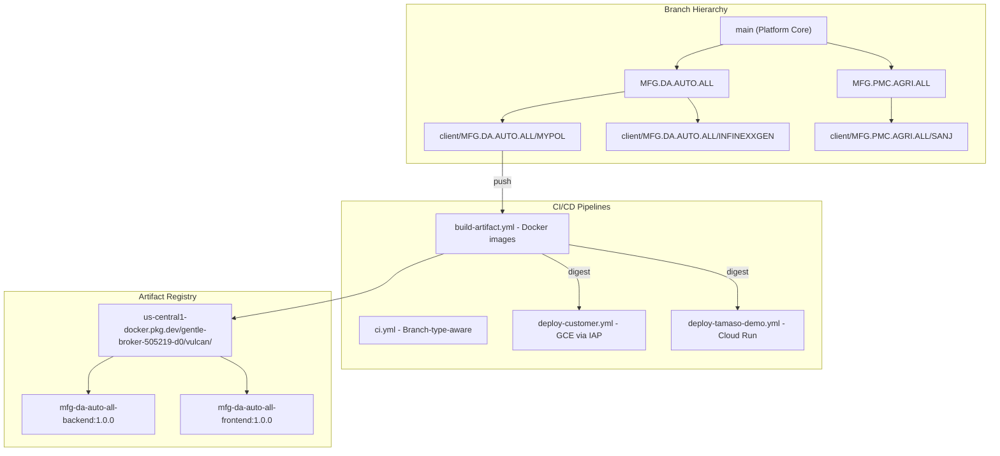
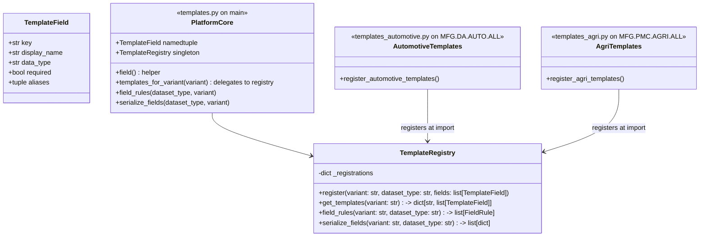
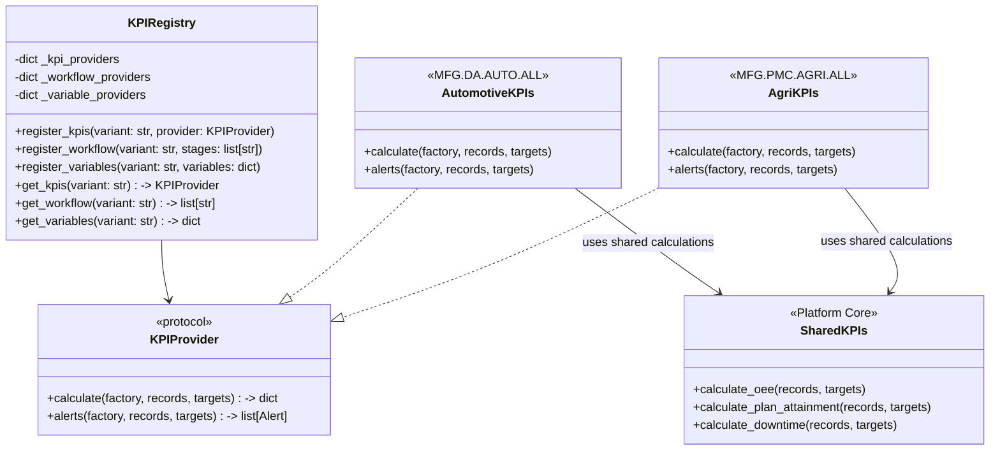
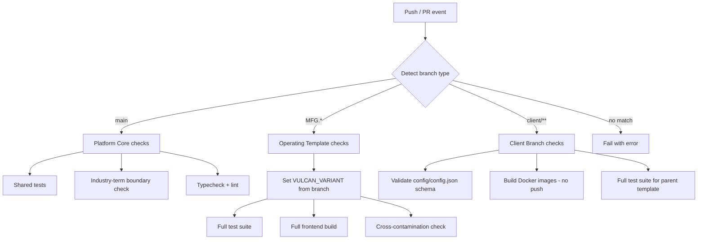
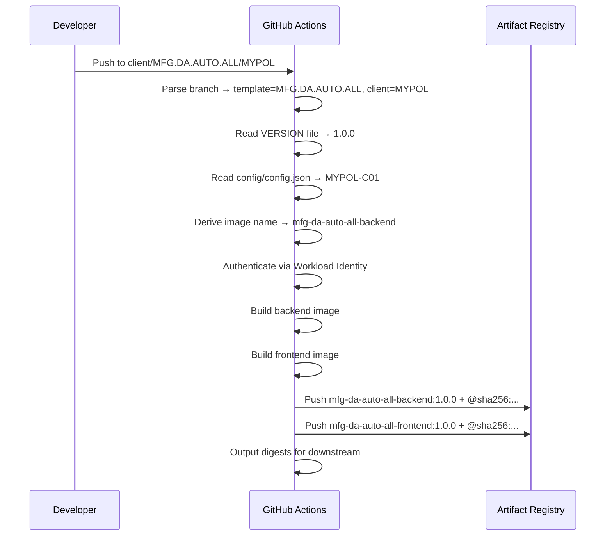
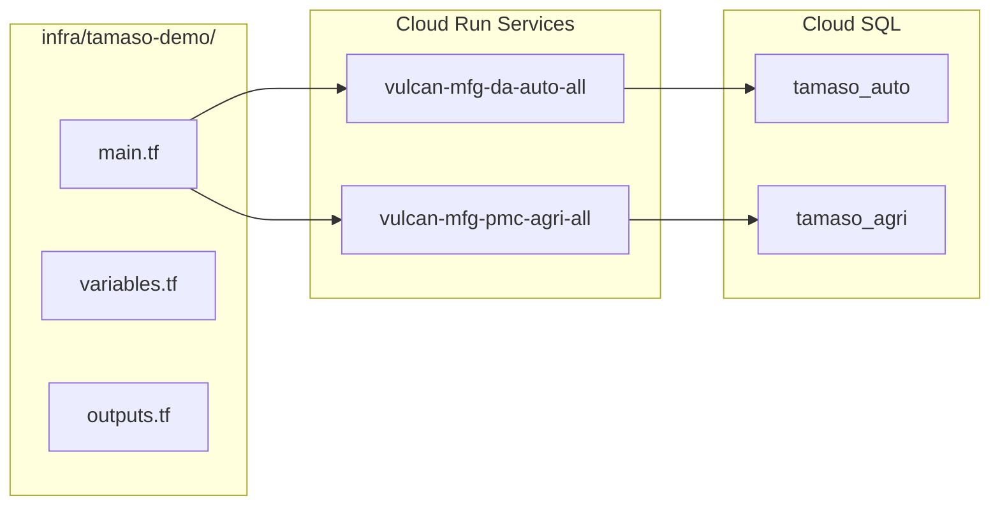

# Design Document: Tamaso Versioning, Deployment & Licensing Architecture

## Overview

This design restructures the vulcan monorepo from a single-branch, environment-variable-toggled dual-variant system into a hierarchical branch architecture with:

- **Platform Core** (`main`): Shared framework code — not deployable on its own
- **Operating Template branches** (e.g., `MFG.DA.AUTO.ALL`): Industry-specific verticals derived from main
- **Client branches** (e.g., `client/MFG.DA.AUTO.ALL/MYPOL`): Customer-specific configuration derived from their operating template

The transformation requires changes to:
1. Backend plugin/registration mechanisms for extensibility
2. Frontend dynamic variant resolution
3. GitHub Actions workflows (CI, Build, Deploy)
4. GCE deployment scripts (digest-based)
5. Terraform (Cloud Run demo infrastructure)
6. Repository cleanup and documentation

### Key Design Principles

- **Convention over configuration**: Operating templates register plugins by placing files in well-known paths
- **Fail-closed**: Platform Core refuses to start without a valid variant; CI rejects unrecognized branch types
- **Immutability**: Deployments reference images by digest, never mutable tags alone
- **Isolation**: Industry-specific code lives only on its template branch; boundary checking enforces this at CI time

---

## Architecture



### Merge Direction

Merges flow **downward only**: `main` → operating template → client branch. Reverse merges (cherry-picks from template to main) require PR review and must not carry industry-specific code.

---

## Components and Interfaces

### 1. Processing Template Plugin System

**Current state**: `processing/templates.py` is a 650-line file containing mushroom field definitions as the base `TEMPLATES` dict, with `templates_for_variant("automotive")` dynamically filtering/relabeling fields.

**New design**: A lightweight registration mechanism where Platform Core provides the framework and each operating template registers its definitions at import time via a discoverable module.



#### Registration Mechanism

Platform Core `processing/templates.py`:

```python
from processing.mapping import TemplateField
from processing.validation import FieldRule

def field(key, label, data_type="string", required=False, aliases=()):
    return TemplateField(key, label, data_type, required, tuple(aliases))

class TemplateRegistry:
    def __init__(self):
        self._registrations: dict[str, dict[str, list[TemplateField]]] = {}

    def register(self, variant: str, dataset_type: str, fields: list[TemplateField]):
        self._registrations.setdefault(variant, {})[dataset_type] = fields

    def get_templates(self, variant: str) -> dict[str, list[TemplateField]]:
        if variant not in self._registrations:
            raise ValueError(
                f"No template definitions registered for variant {variant!r}. "
                f"Available: {sorted(self._registrations)}."
            )
        return self._registrations[variant]

    def has_variant(self, variant: str) -> bool:
        return variant in self._registrations

_registry = TemplateRegistry()

def templates_for_variant(variant: str) -> dict[str, list[TemplateField]]:
    return _registry.get_templates(variant)

def field_rules(dataset_type: str, variant: str) -> list[FieldRule]:
    return [
        FieldRule(f.key, f.required, f.data_type, 0 if f.data_type == "decimal" else None)
        for f in _registry.get_templates(variant)[dataset_type]
    ]

def serialize_fields(dataset_type: str, variant: str) -> list[dict]:
    return [
        {
            "key": f.key,
            "label": f.display_name,
            "type": "number" if f.data_type == "decimal" else f.data_type,
            "required": f.required,
            "aliases": list(f.aliases),
        }
        for f in _registry.get_templates(variant)[dataset_type]
    ]
```

#### Discovery Mechanism

Platform Core discovers and imports template plugins at Django startup via `AppConfig.ready()` in `processing/apps.py`:

```python
import importlib
from django.apps import AppConfig
from django.conf import settings

class ProcessingConfig(AppConfig):
    name = "processing"

    def ready(self):
        variant = settings.VULCAN_VARIANT
        module_name = f"processing.templates_{variant}"
        try:
            importlib.import_module(module_name)
        except ModuleNotFoundError:
            pass  # Platform Core alone has no template modules
```

On the `MFG.DA.AUTO.ALL` branch, the file `processing/templates_automotive.py` exists and registers all automotive fields when imported:

```python
from processing.templates import _registry, field

_registry.register("automotive", "projects", [
    field("project_number", "Project number", required=True, aliases=["project no"]),
    field("customer", "Customer", required=True, aliases=["customer name", "client"]),
    # ... all automotive-specific field definitions
])

_registry.register("automotive", "production", [
    # ... automotive production fields
])
# Repeat for all dataset types
```

---

### 2. Analytics Framework Plugin System

**Current state**: `backend/apps/analytics/workspace.py` has ~200 lines mixing mushroom KPIs (biological efficiency, environment compliance, water productivity, steam recovery) with shared logic (OEE, plan attainment, downtime).

**New design**: Platform Core provides the analytics framework (workspace builder, KPI calculation interface, alert evaluation). Industry-specific implementations register via a similar pattern.



#### Platform Core `workspace.py` (generic framework)

```python
from __future__ import annotations
import importlib
from typing import Protocol

from django.conf import settings

class KPIProvider(Protocol):
    def calculate(self, factory, records, targets: dict) -> dict: ...
    def alerts(self, factory, records, targets: dict) -> list[dict]: ...

class AnalyticsRegistry:
    def __init__(self):
        self._kpi_providers: dict[str, KPIProvider] = {}
        self._workflows: dict[str, list[str]] = {}
        self._variables: dict[str, dict] = {}

    def register_kpis(self, variant: str, provider: KPIProvider):
        self._kpi_providers[variant] = provider

    def register_workflow(self, variant: str, stages: list[str]):
        self._workflows[variant] = stages

    def register_variables(self, variant: str, variables: dict):
        self._variables[variant] = variables

    def get_provider(self, variant: str) -> KPIProvider:
        if variant not in self._kpi_providers:
            raise ValueError(f"No KPI provider registered for variant {variant!r}.")
        return self._kpi_providers[variant]

    def get_workflow(self, variant: str) -> list[str]:
        return self._workflows.get(variant, [])

    def get_variables(self, variant: str) -> dict:
        return self._variables.get(variant, {})

_analytics_registry = AnalyticsRegistry()

# Shared KPI calculations remain here (OEE, downtime, plan attainment)
DEFAULT_TARGETS = {
    "oee": 78,
    "availability": 85,
    "performance": 95,
    "quality": 98,
    "planAttainment": 90,
    "rejectionRate": 5,
    "supplierScore": 85,
    "stockCoverDays": 3,
    "downtimeMinutes": 30,
    "downtimeUnit": "minutes",
}
```

#### Discovery via AppConfig

The `AnalyticsConfig.ready()` method imports `apps.analytics.workspace_{variant}` if it exists:

```python
class AnalyticsConfig(AppConfig):
    name = "apps.analytics"

    def ready(self):
        variant = settings.VULCAN_VARIANT
        module_name = f"apps.analytics.workspace_{variant}"
        try:
            importlib.import_module(module_name)
        except ModuleNotFoundError:
            pass
```

On `MFG.PMC.AGRI.ALL`, the file `backend/apps/analytics/workspace_agri.py` registers mushroom KPIs:

```python
from apps.analytics.workspace import _analytics_registry, DEFAULT_TARGETS

AGRI_TARGETS = {
    **DEFAULT_TARGETS,
    "biologicalEfficiency": 85,
    "saleableYield": 94,
    "contaminationRate": 2,
    "environmentCompliance": 92,
    "waterProductivity": 1100,
}

class AgriKPIProvider:
    def calculate(self, factory, records, targets):
        # Mushroom-specific KPI calculations
        ...

    def alerts(self, factory, records, targets):
        # Mushroom-specific alert thresholds
        ...

_analytics_registry.register_kpis("agri", AgriKPIProvider())
_analytics_registry.register_workflow("agri", [
    "Compost Preparation", "Pasteurisation & Conditioning",
    "Spawning", "Spawn Run", "Casing", "Pinning",
    "Cropping & Harvest", "Packing & Cold Room",
])
_analytics_registry.register_variables("agri", {
    "mushroom.dry_substrate": ("Dry substrate", "Crop batches", "kg"),
    "mushroom.water_litres": ("Water applied", "Room observations", "litres"),
    "mushroom.biological_efficiency": ("Biological efficiency", "Cultivation KPIs", "%"),
    "mushroom.environment_compliance": ("Environment compliance", "Room observations", "%"),
})
```

---

### 3. Dynamic Variant Loader

#### Backend: `backend/config/variants.py`

**Current state**: Hardcodes `MANIFESTS = {"automotive": ..., "mushroom": ...}` with an allowlist.

**New design**: Discovers a single manifest at `variants/<VULCAN_VARIANT>.json` and validates against `variants/manifest.schema.json`.

```python
import json
from functools import lru_cache
from pathlib import Path
from types import MappingProxyType

import jsonschema
from django.core.exceptions import ImproperlyConfigured

VARIANTS_ROOT = Path(__file__).resolve().parents[2] / "variants"
SCHEMA_PATH = VARIANTS_ROOT / "manifest.schema.json"


@lru_cache(maxsize=1)
def _load_schema() -> dict:
    try:
        return json.loads(SCHEMA_PATH.read_text(encoding="utf-8"))
    except (OSError, json.JSONDecodeError) as exc:
        raise ImproperlyConfigured("Cannot load variant manifest schema.") from exc


@lru_cache(maxsize=1)
def load_variant_manifest(variant: str) -> MappingProxyType:
    """Load the variant manifest for the configured VULCAN_VARIANT."""
    if not variant or not variant.strip():
        raise ImproperlyConfigured(
            "VULCAN_VARIANT environment variable must be set to a non-empty value. "
            "Platform Core is not deployable without a variant."
        )

    manifest_path = VARIANTS_ROOT / f"{variant}.json"
    if not manifest_path.is_file():
        raise ImproperlyConfigured(
            f"Variant manifest not found at {manifest_path}. "
            f"Ensure this branch provides variants/{variant}.json."
        )

    try:
        manifest = json.loads(manifest_path.read_text(encoding="utf-8"))
    except (OSError, json.JSONDecodeError) as exc:
        raise ImproperlyConfigured(
            f"Cannot parse variant manifest at {manifest_path}."
        ) from exc

    schema = _load_schema()
    try:
        jsonschema.validate(manifest, schema)
    except jsonschema.ValidationError as exc:
        raise ImproperlyConfigured(
            f"Variant manifest validation failed: {exc.message}"
        ) from exc

    if manifest["id"] != variant:
        raise ImproperlyConfigured(
            f"Manifest 'id' field ({manifest['id']!r}) must match VULCAN_VARIANT ({variant!r})."
        )

    return MappingProxyType(manifest)
```

#### Manifest JSON Schema: `variants/manifest.schema.json`

```json
{
  "$schema": "https://json-schema.org/draft/2020-12/schema",
  "type": "object",
  "required": ["id", "displayName", "industry", "modules", "datasets", "navigation", "terminology", "features"],
  "properties": {
    "id": { "type": "string", "minLength": 1 },
    "displayName": { "type": "string", "minLength": 1 },
    "descriptor": { "type": "string" },
    "industry": { "type": "string", "minLength": 1 },
    "modules": {
      "type": "array",
      "items": { "type": "string" },
      "minItems": 1
    },
    "datasets": {
      "type": "object",
      "additionalProperties": { "type": "string" }
    },
    "navigation": {
      "type": "object",
      "additionalProperties": { "type": "string" }
    },
    "terminology": {
      "type": "object",
      "required": ["siteSingular", "sitePlural", "projectSingular", "projectPlural"],
      "properties": {
        "siteSingular": { "type": "string", "minLength": 1 },
        "sitePlural": { "type": "string", "minLength": 1 },
        "projectSingular": { "type": "string", "minLength": 1 },
        "projectPlural": { "type": "string", "minLength": 1 }
      }
    },
    "features": {
      "type": "object",
      "additionalProperties": { "type": "boolean" }
    }
  },
  "additionalProperties": true
}
```

#### Frontend: `frontend/lib/variant-config.ts`

**Current state**: Static imports of both manifests.

**New design**: Dynamic resolution using `VULCAN_VARIANT` at build time.

```typescript
import "server-only";

import { readFileSync } from "fs";
import { resolve } from "path";
import type { VariantConfig } from "@/lib/variant";

let _cachedConfig: VariantConfig | null = null;

export function getVariantConfig(): VariantConfig {
  if (_cachedConfig) return _cachedConfig;

  const variant = process.env.VULCAN_VARIANT?.trim().toLowerCase();
  if (!variant) {
    throw new Error(
      "VULCAN_VARIANT environment variable must be set. " +
      "Platform Core is not deployable without a variant."
    );
  }

  const manifestPath = resolve(__dirname, "../../variants", `${variant}.json`);
  let raw: string;
  try {
    raw = readFileSync(manifestPath, "utf-8");
  } catch {
    throw new Error(
      `Variant manifest not found at ${manifestPath}. ` +
      `Ensure this branch provides variants/${variant}.json.`
    );
  }

  const manifest = JSON.parse(raw) as VariantConfig;

  // Runtime shape validation
  const required = ["id", "displayName", "industry", "modules", "datasets", "navigation", "terminology", "features"];
  for (const key of required) {
    if (!(key in manifest)) {
      throw new Error(
        `Variant manifest at ${manifestPath} is missing required field: ${key}`
      );
    }
  }

  const termKeys = ["siteSingular", "sitePlural", "projectSingular", "projectPlural"];
  for (const key of termKeys) {
    if (!manifest.terminology || !(key in manifest.terminology)) {
      throw new Error(
        `Variant manifest terminology is missing required field: ${key}`
      );
    }
  }

  _cachedConfig = manifest;
  return manifest;
}
```

#### Frontend: `frontend/lib/variant.tsx`

```typescript
"use client";

import { createContext, useContext } from "react";

// Extensible: any operating template can declare its own id string
export type VariantId = string;

export interface VariantConfig {
  id: VariantId;
  displayName: string;
  descriptor?: string;
  industry: string;
  modules: string[];
  datasets: Record<string, string>;
  navigation: Record<string, string>;
  terminology: {
    siteSingular: string;
    sitePlural: string;
    projectSingular: string;
    projectPlural: string;
  };
  features: Record<string, boolean>;
}

const VariantContext = createContext<VariantConfig | null>(null);

export function VariantProvider({
  config,
  children,
}: {
  config: VariantConfig;
  children: React.ReactNode;
}) {
  return <VariantContext.Provider value={config}>{children}</VariantContext.Provider>;
}

export function useVariant(): VariantConfig {
  const config = useContext(VariantContext);
  if (!config) throw new Error("useVariant must be used inside VariantProvider.");
  return config;
}
```

---

### 4. CI Pipeline: Branch-Type Detection

**Workflow file**: `.github/workflows/ci.yml`



#### Branch Type Detection Logic

```yaml
jobs:
  detect:
    runs-on: ubuntu-latest
    outputs:
      branch_type: ${{ steps.detect.outputs.type }}
      variant: ${{ steps.detect.outputs.variant }}
      template: ${{ steps.detect.outputs.template }}
    steps:
      - id: detect
        run: |
          REF="${GITHUB_BASE_REF:-$GITHUB_REF_NAME}"
          if [[ "$REF" == "main" ]]; then
            echo "type=platform_core" >> "$GITHUB_OUTPUT"
          elif [[ "$REF" =~ ^MFG\.[A-Z0-9]{2,5}\.[A-Z0-9]{2,5}\.[A-Z0-9]{2,5}$ ]]; then
            echo "type=operating_template" >> "$GITHUB_OUTPUT"
            # Derive variant name: MFG.DA.AUTO.ALL -> automotive (from manifest)
            echo "template=$REF" >> "$GITHUB_OUTPUT"
          elif [[ "$REF" =~ ^client/([^/]+)/([A-Z0-9]{3,12})$ ]]; then
            echo "type=client_branch" >> "$GITHUB_OUTPUT"
            echo "template=${BASH_REMATCH[1]}" >> "$GITHUB_OUTPUT"
            echo "client=${BASH_REMATCH[2]}" >> "$GITHUB_OUTPUT"
          else
            echo "::error::Branch '$REF' does not match any recognized pattern (main, MFG.*, client/**)."
            exit 1
          fi
```

#### Industry-Term Boundary Check (Platform Core)

A CI step that scans source files for industry-specific identifiers:

```yaml
      - name: Industry-term boundary check
        if: needs.detect.outputs.branch_type == 'platform_core'
        run: |
          DENY_FILE=".kiro/industry-terms.txt"
          if [[ ! -f "$DENY_FILE" ]]; then
            echo "::error::Deny-list file $DENY_FILE not found."
            exit 1
          fi
          PATTERN=$(grep -v '^#' "$DENY_FILE" | grep -v '^$' | paste -sd '|' -)
          VIOLATIONS=$(grep -rn --include='*.py' --include='*.ts' --include='*.tsx' \
            -E "($PATTERN)" backend/ frontend/ processing/ || true)
          if [[ -n "$VIOLATIONS" ]]; then
            echo "::error::Industry-specific terms found on Platform Core:"
            echo "$VIOLATIONS"
            exit 1
          fi
```

**`.kiro/industry-terms.txt`** (deny-list):
```
# Industry-specific identifiers that must not appear on Platform Core
mushroom
automotive
agri
cultivation
harvest
crop
spawn
substrate
flush
compost
MYPOL
INFINEXXGEN
SANJ
```

---

### 5. Build Pipeline

**Workflow file**: `.github/workflows/build-artifact.yml`

Triggered on pushes to `client/**` branches. Builds both Docker images and publishes to Artifact Registry.



#### Key Workflow Structure

```yaml
name: Build Artifact
on:
  push:
    branches: ["client/**"]

permissions:
  contents: read
  id-token: write

jobs:
  prepare:
    runs-on: ubuntu-latest
    outputs:
      template: ${{ steps.parse.outputs.template }}
      client_code: ${{ steps.parse.outputs.client_code }}
      image_prefix: ${{ steps.parse.outputs.image_prefix }}
      version: ${{ steps.version.outputs.version }}
      config_version: ${{ steps.config.outputs.config_version }}
      variant: ${{ steps.variant.outputs.variant }}
    steps:
      - uses: actions/checkout@v4
      - id: parse
        run: |
          BRANCH="${GITHUB_REF_NAME}"
          TEMPLATE=$(echo "$BRANCH" | cut -d'/' -f2)
          CLIENT=$(echo "$BRANCH" | cut -d'/' -f3)
          PREFIX=$(echo "$TEMPLATE" | tr '.' '-' | tr 'A-Z' 'a-z')
          echo "template=$TEMPLATE" >> "$GITHUB_OUTPUT"
          echo "client_code=$CLIENT" >> "$GITHUB_OUTPUT"
          echo "image_prefix=$PREFIX" >> "$GITHUB_OUTPUT"
      - id: version
        run: echo "version=$(cat VERSION)" >> "$GITHUB_OUTPUT"
      - id: config
        run: |
          CONFIG_VERSION=$(jq -r '.configVersion' config/config.json)
          echo "config_version=$CONFIG_VERSION" >> "$GITHUB_OUTPUT"
      - id: variant
        run: |
          VARIANT=$(jq -r '.id' variants/*.json)
          echo "variant=$VARIANT" >> "$GITHUB_OUTPUT"

  build:
    needs: prepare
    runs-on: ubuntu-latest
    strategy:
      fail-fast: true
      matrix:
        image: [backend, frontend]
    outputs:
      backend_digest: ${{ steps.push.outputs.digest }}
      frontend_digest: ${{ steps.push.outputs.digest }}
    steps:
      - uses: actions/checkout@v4
      - uses: google-github-actions/auth@v3
        with:
          workload_identity_provider: ${{ vars.GCP_WORKLOAD_IDENTITY_PROVIDER }}
          service_account: ${{ vars.GCP_DEPLOY_SERVICE_ACCOUNT }}
      - uses: docker/setup-buildx-action@v3
      - uses: docker/build-push-action@v6
        id: push
        with:
          context: .
          file: ${{ matrix.image }}/Dockerfile
          push: true
          tags: |
            ${{ env.GCP_REGION }}-docker.pkg.dev/${{ env.GCP_PROJECT_ID }}/${{ env.AR_REPOSITORY }}/${{ needs.prepare.outputs.image_prefix }}-${{ matrix.image }}:${{ needs.prepare.outputs.version }}
            ${{ env.GCP_REGION }}-docker.pkg.dev/${{ env.GCP_PROJECT_ID }}/${{ env.AR_REPOSITORY }}/${{ needs.prepare.outputs.image_prefix }}-${{ matrix.image }}:${{ github.sha }}
          build-args: |
            VULCAN_VARIANT=${{ needs.prepare.outputs.variant }}
            CONFIG_VERSION=${{ needs.prepare.outputs.config_version }}
            PLATFORM_VERSION=${{ needs.prepare.outputs.version }}
          labels: |
            com.tamaso.config-version=${{ needs.prepare.outputs.config_version }}
          cache-from: type=gha,scope=${{ needs.prepare.outputs.client_code }}-${{ matrix.image }}
          cache-to: type=gha,mode=max,scope=${{ needs.prepare.outputs.client_code }}-${{ matrix.image }}
```

---

### 6. Deployment Pipeline and Deploy Script

#### Customer GCE Deployment Workflow

**File**: `.github/workflows/deploy-customer.yml`

```yaml
name: Deploy to Customer GCE
on:
  workflow_dispatch:
    inputs:
      customer_id:
        description: "Client code (e.g., MYPOL)"
        required: true
        type: string
      deployment_id:
        description: "Deployment identifier"
        required: true
        type: string
      backend_digest:
        description: "Backend image digest (sha256:...)"
        required: true
        type: string
      frontend_digest:
        description: "Frontend image digest (sha256:...)"
        required: true
        type: string
      config_version:
        description: "Config version (e.g., MYPOL-C01)"
        required: true
        type: string
      reason:
        description: "Deployment reason"
        required: true
        type: string

concurrency:
  group: deploy-${{ inputs.customer_id }}
  cancel-in-progress: false
```

#### Updated Deploy Script: `deploy/gce-customer/deploy.sh`

The new script accepts digest-pinned images rather than git SHAs:

```bash
#!/usr/bin/env bash
set -Eeuo pipefail

# Arguments: <backend_digest> <frontend_digest> <config_version> <deployment_id>
if [[ $# -ne 4 ]]; then
  echo "Usage: $0 <backend_digest> <frontend_digest> <config_version> <deployment_id>" >&2
  exit 2
fi

backend_digest="$1"
frontend_digest="$2"
config_version="$3"
deployment_id="$4"

# Validate digest format
for digest in "$backend_digest" "$frontend_digest"; do
  if [[ ! "$digest" =~ ^sha256:[a-f0-9]{64}$ ]]; then
    echo "Invalid digest format: $digest" >&2
    exit 2
  fi
done

cd /opt/tamaso
exec 9>/run/tamaso-deploy.lock
flock -n 9 || { echo "Another deployment is running." >&2; exit 1; }

set -a; source .env; set +a
: "${GCP_REGION:?}" "${GCP_PROJECT_ID:?}" "${AR_REPOSITORY:?}"
: "${IMAGE_PREFIX:?}" "${CUSTOMER_ID:?}"

# Pre-deployment backup (MUST succeed before proceeding)
./backup.sh || { echo "Backup failed, refusing to deploy." >&2; exit 1; }

registry="${GCP_REGION}-docker.pkg.dev"
access_token="$(curl --fail --silent -H 'Metadata-Flavor: Google' \
  'http://metadata.google.internal/computeMetadata/v1/instance/service-accounts/default/token' |
  python3 -c 'import json,sys; print(json.load(sys.stdin)["access_token"])')"
printf '%s' "$access_token" | docker login -u oauth2accesstoken --password-stdin "$registry"

backend_image="${registry}/${GCP_PROJECT_ID}/${AR_REPOSITORY}/${IMAGE_PREFIX}-backend@${backend_digest}"
frontend_image="${registry}/${GCP_PROJECT_ID}/${AR_REPOSITORY}/${IMAGE_PREFIX}-frontend@${frontend_digest}"

# Save previous state for rollback
cp .env .env.rollback

# Update environment
sed -i "s|^BACKEND_IMAGE=.*|BACKEND_IMAGE=${backend_image}|" .env
sed -i "s|^FRONTEND_IMAGE=.*|FRONTEND_IMAGE=${frontend_image}|" .env
sed -i "s|^CONFIG_VERSION=.*|CONFIG_VERSION=${config_version}|" .env

rollback() {
  echo "ROLLING BACK to previous deployment state..." >&2
  cp .env.rollback .env
  set -a; source .env; set +a
  docker compose --env-file .env up -d --remove-orphans --wait --wait-timeout 180 || true
  local ts; ts="$(date -u +%Y-%m-%dT%H:%M:%SZ)"
  printf '{"timestamp":"%s","customer_id":"%s","deployment_id":"%s","config_version":"%s","backend_digest":"%s","frontend_digest":"%s","platform_version":"%s","status":"ROLLBACK"}\n' \
    "$ts" "$CUSTOMER_ID" "$deployment_id" "$config_version" "$backend_digest" "$frontend_digest" "${PLATFORM_VERSION:-unknown}" \
    >> /opt/tamaso/deployments.json
  echo "Rollback complete." | tee -a /opt/tamaso/deployment-failures.log
}
trap rollback ERR

# Pull images by digest
docker compose --env-file .env pull

# Show migration plan
docker compose --env-file .env run --rm backend python backend/manage.py migrate --plan

# Stop old containers, apply migrations
docker compose --env-file .env stop frontend backend
docker compose --env-file .env run --rm backend python backend/manage.py migrate --noinput
docker compose --env-file .env run --rm backend python backend/manage.py collectstatic --noinput

# Start new containers and wait for health (180s timeout)
docker compose --env-file .env up -d --remove-orphans --wait --wait-timeout 180

trap - ERR

# Record successful deployment
ts="$(date -u +%Y-%m-%dT%H:%M:%SZ)"
printf '{"timestamp":"%s","customer_id":"%s","deployment_id":"%s","config_version":"%s","backend_digest":"%s","frontend_digest":"%s","platform_version":"%s","status":"SUCCESS"}\n' \
  "$ts" "$CUSTOMER_ID" "$deployment_id" "$config_version" "$backend_digest" "$frontend_digest" "${PLATFORM_VERSION:-unknown}" \
  >> /opt/tamaso/deployments.json

docker logout "$registry" >/dev/null
echo "Deployed ${CUSTOMER_ID} config ${config_version}"
```

---

### 7. Tamaso Demo Terraform Structure

**Directory**: `infra/tamaso-demo/`

The Terraform manages up to 5 Cloud Run services (one per operating template), each with its own database, service account, and IAM-restricted access.



#### `infra/tamaso-demo/variables.tf`

```hcl
variable "project_id" {
  description = "GCP project for Tamaso demo."
  type        = string
}

variable "region" {
  description = "Cloud Run region."
  type        = string
  default     = "us-central1"
}

variable "templates" {
  description = "Operating templates to deploy as demo services."
  type = map(object({
    backend_image  = string
    frontend_image = string
    domain         = string
    database_name  = string
    variant_id     = string
  }))

  validation {
    condition = alltrue([
      for name, config in var.templates :
      can(regex("^[a-z0-9-]+$", name))
      && strcontains(config.backend_image, "@sha256:")
      && strcontains(config.frontend_image, "@sha256:")
    ])
    error_message = "Template names must be lowercase-dashes; images must be digest-pinned."
  }
}

variable "authorized_members" {
  description = "IAM members allowed to invoke demo services."
  type        = list(string)
}
```

#### Key Design Decisions

- Uses `var.templates` map instead of hardcoded variant names — any operating template can be added
- Images are validated to be digest-pinned (immutable)
- IAM-restricted: only listed `authorized_members` get Cloud Run Invoker role
- Each template gets its own service account, database, and storage bucket
- Traffic always routes to latest healthy revision (unhealthy revisions are not promoted)

---

### 8. Client Configuration Schema and Loading

#### `config/config.json` (lives on client branches only)

```json
{
  "clientId": "MYPOL",
  "displayName": "MyPol Automotive Mysuru",
  "factoryCode": "MYPOL-MYSURU",
  "configVersion": "MYPOL-C01",
  "environmentOverrides": {
    "DJANGO_LOG_LEVEL": "DEBUG"
  }
}
```

#### JSON Schema for CI Validation: `config/config.schema.json`

```json
{
  "$schema": "https://json-schema.org/draft/2020-12/schema",
  "type": "object",
  "required": ["clientId", "displayName", "factoryCode", "configVersion"],
  "properties": {
    "clientId": {
      "type": "string",
      "pattern": "^[A-Z0-9]{3,12}$"
    },
    "displayName": {
      "type": "string",
      "minLength": 1
    },
    "factoryCode": {
      "type": "string",
      "minLength": 1
    },
    "configVersion": {
      "type": "string",
      "pattern": "^[A-Z0-9]{3,12}-C[0-9]{2}$"
    },
    "environmentOverrides": {
      "type": "object",
      "additionalProperties": { "type": "string" }
    }
  },
  "additionalProperties": false
}
```

#### CI Validation Step (client branch builds)

```yaml
      - name: Validate client configuration
        run: |
          # Validate schema
          npx ajv-cli validate -s config/config.schema.json -d config/config.json

          # Validate configVersion matches client code from branch
          CLIENT_CODE=$(echo "$GITHUB_REF_NAME" | cut -d'/' -f3)
          CONFIG_VERSION=$(jq -r '.configVersion' config/config.json)
          CLIENT_ID=$(jq -r '.clientId' config/config.json)

          if [[ "$CLIENT_ID" != "$CLIENT_CODE" ]]; then
            echo "::error::clientId ($CLIENT_ID) does not match branch client code ($CLIENT_CODE)"
            exit 1
          fi

          if [[ ! "$CONFIG_VERSION" =~ ^${CLIENT_CODE}-C[0-9]{2}$ ]]; then
            echo "::error::configVersion ($CONFIG_VERSION) does not follow pattern ${CLIENT_CODE}-CXX"
            exit 1
          fi
```

---

### 9. Industry-Term Boundary Checking

The boundary check prevents industry-specific identifiers from leaking into Platform Core.

#### Deny-List File: `.kiro/industry-terms.txt`

```text
# Industry terms that must not appear on Platform Core source files.
# One term per line. Lines starting with # are comments.
# Matching is case-insensitive.
mushroom
automotive
agri
cultivation
harvest
crop
spawn
substrate
flush
compost
MYPOL
INFINEXXGEN
SANJ
```

#### Implementation as CI Step

```yaml
      - name: Industry-term boundary check
        run: |
          DENY_FILE=".kiro/industry-terms.txt"
          # Build regex pattern from deny-list (skip comments and blanks)
          PATTERN=$(grep -v '^#' "$DENY_FILE" | grep -v '^\s*$' | tr '\n' '|' | sed 's/|$//')

          # Scan application source files (case-insensitive)
          VIOLATIONS=$(grep -rniE "($PATTERN)" \
            --include='*.py' --include='*.ts' --include='*.tsx' --include='*.js' \
            backend/ frontend/ processing/ 2>/dev/null || true)

          if [[ -n "$VIOLATIONS" ]]; then
            echo "::error::Industry-specific terms found on Platform Core:"
            echo "$VIOLATIONS" | while IFS= read -r line; do
              FILE=$(echo "$line" | cut -d: -f1)
              LINE_NUM=$(echo "$line" | cut -d: -f2)
              echo "::error file=$FILE,line=$LINE_NUM::$line"
            done
            exit 1
          fi
          echo "✓ No industry-specific terms found in source files."
```

#### Cross-Contamination Check (Operating Template branches)

A similar check runs on operating template branches to ensure one template doesn't reference another:

```yaml
      - name: Cross-contamination check
        if: needs.detect.outputs.branch_type == 'operating_template'
        run: |
          TEMPLATE="${{ needs.detect.outputs.template }}"
          # Build deny pattern for OTHER templates' terms
          # Each template has a deny file listing terms from other industries
          DENY_FILE=".kiro/cross-contamination-deny.txt"
          if [[ ! -f "$DENY_FILE" ]]; then
            echo "No cross-contamination deny list found, skipping."
            exit 0
          fi
          PATTERN=$(grep -v '^#' "$DENY_FILE" | grep -v '^\s*$' | tr '\n' '|' | sed 's/|$//')
          VIOLATIONS=$(grep -rniE "($PATTERN)" \
            --include='*.py' --include='*.ts' --include='*.tsx' \
            processing/ backend/apps/analytics/ backend/apps/tenancy/ 2>/dev/null || true)
          if [[ -n "$VIOLATIONS" ]]; then
            echo "::error::Cross-contamination detected on $TEMPLATE:"
            echo "$VIOLATIONS"
            exit 1
          fi
```

---

## Data Models

### Client Configuration Model

| Field | Type | Constraints | Description |
|-------|------|-------------|-------------|
| `clientId` | string | `^[A-Z0-9]{3,12}$` | Matches the client code in branch name |
| `displayName` | string | non-empty | Human-readable customer name |
| `factoryCode` | string | non-empty | Factory identifier for seed data |
| `configVersion` | string | `^[A-Z0-9]{3,12}-C[0-9]{2}$` | Monotonically increasing version |
| `environmentOverrides` | object | string values | Optional env var overrides |

### Variant Manifest Model

| Field | Type | Constraints | Description |
|-------|------|-------------|-------------|
| `id` | string | non-empty, matches VULCAN_VARIANT | Variant identifier |
| `displayName` | string | non-empty | Product display name |
| `descriptor` | string | optional | Short description |
| `industry` | string | non-empty | Industry classification |
| `modules` | string[] | min 1 item | Enabled application modules |
| `datasets` | Record<string, string> | — | Dataset type to display label mapping |
| `navigation` | Record<string, string> | — | Navigation key to label mapping |
| `terminology` | object | 4 required string fields | Site/project terminology |
| `features` | Record<string, boolean> | — | Feature flags |

### Branch Naming Model

| Type | Pattern | Example | Max Length |
|------|---------|---------|------------|
| Operating Template | `MFG.<DISC>.<IND>.<SCOPE>` | `MFG.DA.AUTO.ALL` | 30 chars |
| Client Branch | `client/<TEMPLATE>/<CLIENT>` | `client/MFG.DA.AUTO.ALL/MYPOL` | — |
| Segment | `[A-Z0-9]{2,5}` | `DA`, `AUTO`, `ALL` | 5 chars |
| Client Code | `[A-Z0-9]{3,12}` | `MYPOL`, `INFINEXXGEN` | 12 chars |

### Deployment Record Model (`/opt/tamaso/deployments.json` entries)

| Field | Type | Description |
|-------|------|-------------|
| `timestamp` | string (ISO 8601) | Deployment time |
| `customer_id` | string | Client code |
| `deployment_id` | string | Unique deployment identifier |
| `config_version` | string | Config version deployed |
| `backend_digest` | string | `sha256:...` digest |
| `frontend_digest` | string | `sha256:...` digest |
| `platform_version` | string | SemVer from VERSION file |
| `status` | string | `SUCCESS` or `ROLLBACK` |

---

## Correctness Properties

*A property is a characteristic or behavior that should hold true across all valid executions of a system — essentially, a formal statement about what the system should do. Properties serve as the bridge between human-readable specifications and machine-verifiable correctness guarantees.*

After analyzing the requirements, the testable properties focus on the pure logic components: the variant manifest loading/validation, template registry, branch name parsing, config version validation, and artifact name derivation. The IaC (Terraform), deployment scripts (side-effects), and CI workflow configurations are better tested through integration/smoke tests.

### Property 1: Variant manifest round-trip

*For any* valid variant manifest object conforming to the schema, serializing it to JSON and loading it through `load_variant_manifest` SHALL produce a manifest whose `id`, `displayName`, `industry`, `modules`, `datasets`, `navigation`, `terminology`, and `features` fields are identical to the original.

**Validates: Requirements 1.4, 1.5, 11.1**

### Property 2: Template registry isolation

*For any* two distinct variant identifiers V1 and V2 and any set of field definitions registered under each, calling `templates_for_variant(V1)` SHALL return only the fields registered for V1, with no fields from V2 present, and vice versa.

**Validates: Requirements 2.2, 2.3, 10.2, 10.3**

### Property 3: Operating template branch name validation

*For any* string matching the regex `^MFG\.[A-Z0-9]{2,5}\.[A-Z0-9]{2,5}\.[A-Z0-9]{2,5}$` with total length ≤ 30, the branch name parsing function SHALL accept it as a valid operating template name; for any string not matching this pattern, it SHALL reject it.

**Validates: Requirements 2.1**

### Property 4: Client branch name validation

*For any* string matching `^client/MFG\.[A-Z0-9]{2,5}\.[A-Z0-9]{2,5}\.[A-Z0-9]{2,5}/[A-Z0-9]{3,12}$`, the branch parsing function SHALL extract both a valid operating template name and a valid client code; for strings not matching, it SHALL reject.

**Validates: Requirements 3.1**

### Property 5: Config version monotonicity pattern

*For any* client code C and integer N ≥ 1, the config version string `C-C<zero-padded N>` SHALL be valid, and for any config version string, extracting the client code prefix SHALL equal the `clientId` field in the config.

**Validates: Requirements 3.3, 3.4**

### Property 6: Artifact name derivation is deterministic and reversible

*For any* valid operating template branch name, the artifact naming function (dots to dashes, lowercase) SHALL produce a string matching `^[a-z0-9-]+$`, and applying the transformation twice SHALL yield the same result (idempotence on the lowercased-dashed form).

**Validates: Requirements 4.1, 4.2**

### Property 7: Industry-term boundary checker rejects all deny-listed terms

*For any* term T in the deny-list and any source file content containing T (case-insensitively), the boundary check function SHALL report at least one violation referencing that file path and line.

**Validates: Requirements 1.2, 1.3**

### Property 8: Missing variant manifest fails startup

*For any* non-empty string V where `variants/V.json` does not exist on disk, calling `load_variant_manifest(V)` SHALL raise `ImproperlyConfigured` with a message containing the missing path.

**Validates: Requirements 1.6, 11.4**

---

## Error Handling

### Startup Failures

| Scenario | Behavior | Exit Code |
|----------|----------|-----------|
| `VULCAN_VARIANT` unset or empty | `ImproperlyConfigured` with clear message | Django refuses to start |
| Manifest file missing | `ImproperlyConfigured` naming the expected path | Django refuses to start |
| Manifest fails schema validation | `ImproperlyConfigured` with validation error details | Django refuses to start |
| Template plugin module missing | Silent (expected on Platform Core) | App starts without template registrations |
| Frontend manifest missing | Build-time error with path and reason | `next build` exits non-zero |

### CI Pipeline Failures

| Scenario | Behavior |
|----------|----------|
| Branch name doesn't match any pattern | Job fails with descriptive error naming the branch |
| Industry terms found on Platform Core | Job fails, reports file:line for each violation |
| Cross-contamination on template branch | Job fails, reports offending imports |
| Client config schema validation fails | Job fails with schema error details |
| configVersion doesn't match clientId pattern | Job fails with mismatch details |

### Build Pipeline Failures

| Scenario | Behavior |
|----------|----------|
| Docker build fails | Entire workflow fails, no images pushed |
| Artifact Registry push fails | Workflow fails with image name and error reason, no deployment proceeds |
| VERSION file missing or malformed | Prepare job fails before build starts |

### Deployment Failures

| Scenario | Behavior |
|----------|----------|
| Pre-deploy backup fails | Script exits immediately, no changes made |
| Migration fails | Rollback: restore previous .env, restart old containers |
| Containers don't become healthy in 180s | Rollback: restore previous images, log failure |
| Health check fails post-deploy | Pipeline reports failure (containers may still be running) |

### Rollback Guarantees

The deploy script implements automatic rollback via bash `trap ERR`:
1. Previous `.env` is saved as `.env.rollback` before any changes
2. On any failure after backup, the trap restores the previous environment and restarts containers
3. A `ROLLBACK` entry is appended to `deployments.json` for audit trail
4. Failures are logged to `/opt/tamaso/deployment-failures.log`

---

## Testing Strategy

### Unit Tests (example-based)

| Component | Test Focus |
|-----------|------------|
| `variants.py` loader | Specific valid/invalid manifests, missing fields, wrong types |
| Template registry | Register then retrieve, unknown variant errors |
| Analytics registry | Provider registration, missing provider errors |
| Branch name parser | Specific valid names, edge cases (max length, min segments) |
| Config version parser | Valid patterns, boundary values |
| `getVariantConfig()` (frontend) | Missing env var, malformed JSON, missing fields |

### Property-Based Tests (using Hypothesis for Python, fast-check for TypeScript)

Each property test runs a minimum of 100 iterations with random inputs.

| Property | Generator Strategy |
|----------|-------------------|
| Manifest round-trip | Generate valid manifest dicts with random strings/booleans |
| Registry isolation | Generate pairs of variant names + random field lists |
| Branch name validation | Generate strings from valid/invalid character sets |
| Config version pattern | Generate valid client codes + integers |
| Artifact name derivation | Generate valid template names, verify transformation |
| Boundary checker | Generate file contents with/without deny-list terms |
| Missing manifest startup | Generate random non-existent variant names |

**Configuration**:
```python
# pytest + hypothesis
from hypothesis import given, settings, strategies as st

@settings(max_examples=200)
@given(variant_name=st.from_regex(r"[a-z][a-z0-9-]{1,20}", fullmatch=True))
def test_missing_manifest_fails(variant_name, tmp_path):
    # Feature: tamaso-versioning-deployment, Property 8: Missing variant manifest fails startup
    ...
```

```typescript
// vitest + fast-check
import fc from "fast-check";

test("artifact name derivation is idempotent", () => {
  // Feature: tamaso-versioning-deployment, Property 6: Artifact name derivation
  fc.assert(
    fc.property(
      fc.stringOf(fc.constantFrom(..."ABCDEFGHIJKLMNOPQRSTUVWXYZ0123456789."), { minLength: 5, maxLength: 30 }),
      (templateName) => {
        const derive = (s: string) => s.replace(/\./g, "-").toLowerCase();
        return derive(templateName) === derive(derive(templateName));
      }
    ),
    { numRuns: 100 }
  );
});
```

### Integration Tests

| Scope | Approach |
|-------|----------|
| CI workflow logic | Act (nektos/act) or manual trigger on test branches |
| Build pipeline | Trigger on test client branch, verify images appear in AR |
| Deploy script | Docker-in-Docker test environment with mock backup/compose |
| Terraform | `terraform plan` against test .tfvars, verify resource counts |

### Smoke Tests

| Check | Method |
|-------|--------|
| Platform Core refuses to start without VULCAN_VARIANT | `python manage.py check` with env unset |
| Frontend build fails without manifest | `npm run build` with VULCAN_VARIANT pointing to missing file |
| Deploy script rejects invalid digest format | Run with malformed argument |
