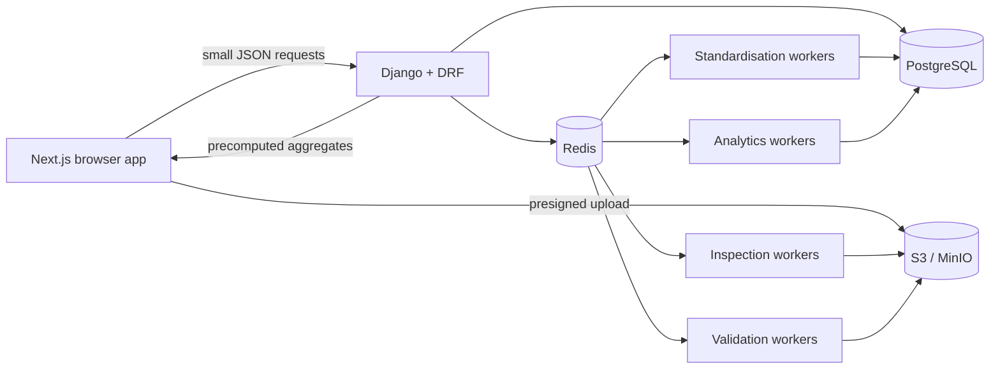

# Architecture

## Shape

Vulcan is a modular monolith with independently scalable background workers.



API and workers deploy from the same backend image. This keeps domain logic in one codebase
while allowing expensive queues to scale independently.

## Domain boundaries

| Module | Owns | Does not own |
|---|---|---|
| `tenancy` | Tenant identity, factories, memberships, assets | Operational facts |
| `operations` | Upload lifecycle, mapping profiles, processing jobs, validation issues | KPI formulas |
| `analytics` | KPI definitions/results, aggregates, losses | File ingestion |
| `alerts` | Versioned rules, evaluations, recommendations | Open-ended content generation |
| `audit` | Actor, event, entity, factory, request context | Domain mutation |
| `processing` | Pure readers, mapping, validation, calculation primitives | HTTP or user permissions |

These boundaries are Python modules, not network services. They can be split later only if
measured scale or team ownership justifies the operational cost.

## Tenancy invariant

Every business model stores `tenant_id`, even when it can be inferred from a factory. This is
intentional:

1. Query scoping is explicit and indexable.
2. Cross-tenant joins can be rejected close to the API boundary.
3. Audit, export, and retention jobs do not have to reconstruct ownership.
4. Future row-level security can use the same column.

`tenant_for_request` resolves the authenticated membership. Factory querysets are then
intersected with the membership's factory access. Frontend filters never grant access.

## Upload lifecycle

The lifecycle is encoded in `UploadState` and `ALLOWED_TRANSITIONS`. A caller cannot skip from
`CREATED` to `COMPLETED`.

```text
CREATED → UPLOADING → UPLOADED → QUEUED → INSPECTING
        → MAPPING_REQUIRED → READY_FOR_VALIDATION → VALIDATING
        → VALIDATION_REVIEW → APPROVED → STANDARDISING
        → CALCULATING_KPIS → GENERATING_ALERTS → COMPLETED
```

Each worker stage has a unique `(upload, stage, processing_version)` job key. Completed jobs
return without repeating side effects; recoverable worker errors retry with exponential backoff
and jitter. Raw object keys include tenant, factory, template, calendar partition, and upload ID.
They are never overwritten.

## Processing safety

- CSV inspection handles UTF-8 BOMs and samples without loading the full file.
- XLSX inspection uses read-only and `data_only` modes with external links disabled. Formulas
  are never executed.
- Mapping uses stable header normalisation, approved profiles, aliases, and deterministic
  similarity. It cannot auto-approve an LLM guess.
- Validation emits structured rule codes and distinguishes warnings from rejected rows.
- OEE calculation validates reconciliation and returns availability, performance, quality,
  result, and formula version.
- Large intermediate datasets belong in Parquet/S3; only approved records and aggregates belong
  in PostgreSQL.

## Dashboard contract

Charts consume aggregate responses with fewer than 5,000 visible points. KPI responses retain
their inputs and definition version. The API never returns raw operational histories merely to
calculate a chart in the browser.

The frontend's `lib/api.ts` is the boundary between UI and backend. Its local fallback is a demo
adapter, not a second business-logic implementation.

## Next delivery slices

1. Add metadata-driven template and rule administration APIs.
2. Connect the pure readers/validators to worker object downloads and Parquet outputs.
3. Add standardised production, downtime, quality, and inventory fact models after the open
   grain/unit/correction decisions in the specification are locked.
4. Materialise line, machine, SKU, shift, inventory-risk, and data-quality aggregates.
5. Add malware scanning and multipart-upload completion.
6. Add object-level approval and recommendation-publication permissions.
7. Add OpenTelemetry/Sentry, queue-depth autoscaling, backup tests, and representative load tests.
