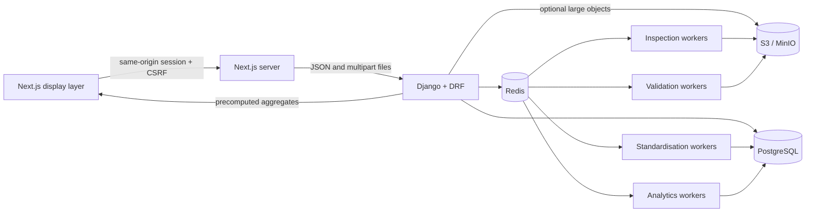

# Architecture

## Shape

Vulcan is a modular monolith with independently scalable background workers.

The same application images can run as an allowlisted `mushroom` or `automotive` deployment. Each
vertical cell has a separate hostname, Cloud Run service, database, bucket, identities and secrets;
the runtime variant cannot be selected by a request. See the [product variant guide](variants.md).



API and future workers deploy from the same backend image. This keeps domain logic in one codebase
while allowing expensive queues to scale independently. The current synchronous import path is the
only complete ingestion route; object-backed worker ingestion remains disabled until download,
malware scanning, parsing and retry handling are implemented end to end.

## Domain boundaries

| Module | Owns | Does not own |
|---|---|---|
| `tenancy` | Tenant identity, factories, memberships, assets | Operational facts |
| `operations` | Upload lifecycle, mapping profiles, processing jobs, validation issues | KPI formulas |
| `analytics` | KPI definitions/results, aggregates, losses | File ingestion |
| `alerts` | Versioned rules, evaluations, recommendations | Open-ended content generation |
| `audit` | Actor, event, entity, factory, request context | Domain mutation |
| `processing` | Pure readers, mapping, validation, calculation primitives | HTTP or user permissions |

These boundaries are Python modules, not network services. They can be split later only if
measured scale or team ownership justifies the operational cost.

## Tenancy invariant

Every business model stores `tenant_id`, even when it can be inferred from a factory. This is
intentional:

1. Query scoping is explicit and indexable.
2. Cross-tenant joins can be rejected close to the API boundary.
3. Audit, export, and retention jobs do not have to reconstruct ownership.
4. Future row-level security can use the same column.

`tenant_for_request` resolves the authenticated membership. Factory querysets are then
intersected with the membership's factory access. Frontend filters never grant access.

## Upload lifecycle

The lifecycle is encoded in `UploadState` and `ALLOWED_TRANSITIONS`. A caller cannot skip from
`CREATED` to `COMPLETED`.

```text
CREATED → UPLOADING → UPLOADED → QUEUED → INSPECTING
        → MAPPING_REQUIRED → READY_FOR_VALIDATION → VALIDATING
        → VALIDATION_REVIEW → APPROVED → STANDARDISING
        → CALCULATING_KPIS → GENERATING_ALERTS → COMPLETED
```

Each worker stage has a unique `(upload, stage, processing_version)` job key. Completed jobs
return without repeating side effects; recoverable worker errors retry with exponential backoff
and jitter. Raw object keys include tenant, factory, template, calendar partition, and upload ID.
They are never overwritten.

## Processing safety

- CSV inspection handles UTF-8 BOMs and samples without loading the full file.
- XLSX inspection uses read-only and `data_only` modes with external links disabled. Formulas
  are never executed.
- Mapping uses stable header normalisation, approved profiles, aliases, and deterministic
  similarity. It cannot auto-approve an LLM guess.
- Validation emits structured rule codes and distinguishes warnings from rejected rows.
- OEE calculation validates reconciliation and returns availability, performance, quality,
  result, and formula version.
- Large intermediate datasets belong in Parquet/S3; only approved records and aggregates belong
  in PostgreSQL.

## Dashboard contract

Charts consume aggregate responses with fewer than 5,000 visible points. KPI responses retain
their inputs and definition version. The API never returns raw operational histories merely to
calculate a chart in the browser.

The frontend's `lib/api-client.ts` is the only data boundary. There is no browser database,
local-storage fallback, validation engine, or KPI engine. Django returns presentation-ready
aggregates; the frontend formats and visualises them.

## Authentication and request boundary

The public surface is the full-viewport landing page and its email/password form. All operational
application routes and business API endpoints require an authenticated Django session. Next.js
proxies `/api/backend/*` to Django, so browser requests, cookies, and CSRF protection remain on one
origin; the backend URL is never a public browser configuration value.

Sign-in follows this sequence:

1. The browser fetches a masked CSRF token and keeps it in memory. It sends that token on the
   sign-in request and every later unsafe request; credentials and session material are never
   persisted in local storage.
2. Django resolves a unique, Unicode-normalised `EmailIdentity`. Unknown identities take the
   same password-hash path as known identities, and failures use one generic response. Passwords
   are stored with Argon2id by preference and Django's supported hashers remain available for
   gradual upgrades.
3. Per-IP and per-account sign-in throttles use opaque cache keys. Production requires the shared
   Redis-backed cache so limits work across application processes.
4. A successful password check must also resolve an active membership in an active tenant.
   Django rotates the session and CSRF secrets, stores the active membership in the server-side
   session, and records the sign-in event in the audit history.
5. Each protected query is scoped again through that membership and its factory access. A factory
   ID from the browser can narrow access but can never expand it. Sign-out is a CSRF-protected POST
   that invalidates the session and records an audit event.

Authentication and personalised API responses are marked private and `no-store`. Session cookies
are HTTP-only and `SameSite=Lax`; non-debug deployments additionally use Secure `__Host-` cookies,
HTTPS redirection, HSTS, clickjacking denial, MIME-sniffing protection, a same-origin referrer
policy, and frontend security headers including a restrictive Content Security Policy. Next.js
generates a fresh nonce for every document request and applies it to framework/page scripts, so
production script execution does not depend on `unsafe-inline`.

Every backend response carries a server-generated request ID that is also bound to structured JSON
production logs. Common credential, session, and token fields are redacted before formatting.
Anonymous sign-in failures are logged without request bodies or plaintext addresses: the account
dimension is a secret-keyed, truncated fingerprint and client IP resolution follows the same
explicit trusted-proxy count as throttling and audit records.

Production configuration fails closed by default: debug mode must be explicitly enabled for local
work, while non-debug startup requires a high-entropy secret key, PostgreSQL URL, Redis/cache URLs,
an exact HTTPS CSRF origin, and an explicit host allowlist; wildcard hosts are rejected.
CORS origins and CSRF trusted origins are separate allowlists. Forwarded protocol/host trust is
disabled unless the deployment explicitly enables it for a known proxy topology, and HSTS
subdomain coverage and preload are separate opt-ins rather than assumptions.
The Django admin URL is registered only in explicit debug mode so its stock login cannot become an
unthrottled production authentication path.

## Current lightweight data shape

Factory identity and master data are relational and factory-scoped. Each upload preserves its
headers, raw rows, approved mapping, omitted columns, validation issues and lineage in Django.
Approved rows become searchable `StandardRecord` rows with common dimensions plus typed JSON
values. Project master and project-stage sheets use the same layer; analytics resolves the newest
approved source per stable project/stage key before building the portfolio, tracker, prediction and
alerts. This keeps the MVP schema small while preserving a clean migration path to dedicated
production, downtime, quality, inventory, order and project fact tables once their grains stabilize.

Trusted seed commands may construct a workspace identity outside an HTTP request, but that helper
is not available to request handlers. Seeded development users require an explicitly supplied
email and password; the repository contains no shared or default login credential.

## Next delivery slices

1. Add metadata-driven template and rule administration APIs.
2. Connect the pure readers/validators to worker object downloads and Parquet outputs.
3. Add standardised production, downtime, quality, and inventory fact models after the open
   grain/unit/correction decisions in the specification are locked.
4. Materialise line, machine, SKU, shift, inventory-risk, and data-quality aggregates.
5. Add malware scanning and multipart-upload completion.
6. Add object-level approval and recommendation-publication permissions.
7. Add passkeys and phishing-resistant MFA, session inventory/revocation, and step-up checks for
   high-impact administrative actions.
8. Add OpenTelemetry/Sentry with request correlation and redaction, queue-depth autoscaling,
   backup-restore tests, and representative load tests.
