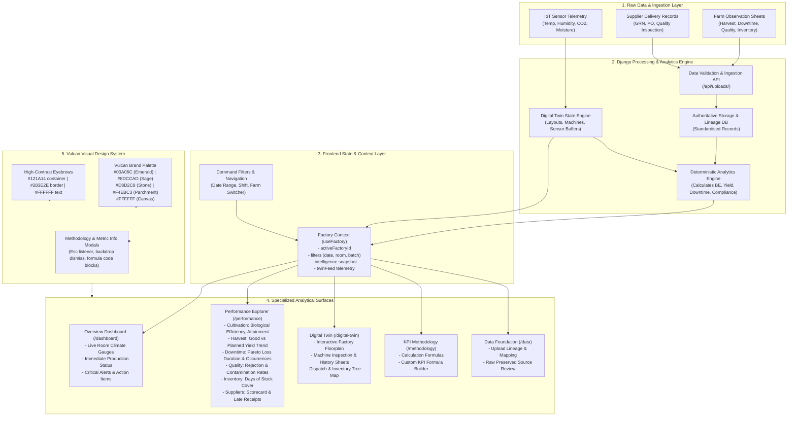

# Vulcan Mushroom - Neural Map of Project Logic

---

## Logic Flow Highlights

1. **Ingestion & Validation Pipeline**:
   - Mapped once per source type. Invalid rows are rejected with explicit discrepancy notes, preserving raw lineage.
2. **Deterministic Calculation**:
   - Zero synthetic smoothing or interpolated metrics.
   - Biological Efficiency = Total Harvest kg ÷ Unique Dry Substrate kg × 100 (batch deduplicated).
   - Climate Compliance = Room readings inside stage limits ÷ Total evaluated readings × 100.
3. **Telemetry & Digital Twin Stream**:
   - Direct real-time binding between room sensors, crop stage setpoints, and interactive visual floorplan.
4. **Ergonomic Presentation**:
   - Tabular figures (`tnum`) across all metrics tables and cards.
   - Dual-layer semantic tokens ensuring WCAG AA (>= 4.5:1) text contrast.
